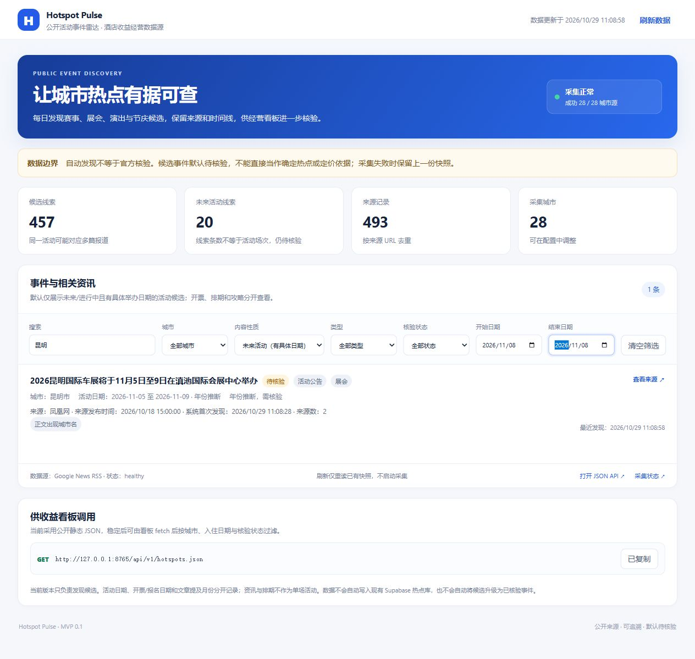

# 真实浏览器验收与首批签核准备

审阅基线为草稿 PR #2 的 `7307102976b374fd8521f6b2e2f905628ee60023`，验收对象为本报告随附的页面修复。实际浏览器观察时间、页面文件 SHA-256 和每项结果见 [同名 JSON](browser-acceptance-2026-10-29.json)。浏览器使用仅绑定本机的临时预览，读取原457条快照；没有启动采集、部署或更新生产文件。

## 浏览器中发现并修复的问题

1. **多日活动漏筛**：昆明车展标题明确11月5日至9日，旧JSON只有11月5日；按11月8日筛选时原来显示0条。页面现仅对未经人工核验、缺少日期语义字段且标题区间能与旧开始日精确对应的记录补充显示结束日，11月8日和9日均可查到，10日不再命中。
2. **历史活动被整月日期遮住**：`evt_d494c40ed023` 标题明确10月18日，旧字段却是10月整月。页面现在对可重现、单一、同月且无售票/报名歧义的具体日期保守读取，该条进入历史视图；不会把旧月份猜成下一年。
3. **旧分类词表遗漏**：补齐“开启报名”“开抢”，12条必选边界不仅不进入未来视图，也能在应属的内容视图中找到。

日期投影只作用于页面内存，不改写原JSON；人工已核验或已有日期语义字段的记录不被覆盖。标题推断仍显示为待核验，不构成事实确认。新增保护测试覆盖原对象不变、人工字段保留、无效区间和过去年份不被编造。

## 实际操作结果

25项有明确预期的浏览器检查通过，包含：默认20条精确候选集合、杭州4条城市筛选、展会6条类型筛选、全部457条、已核验0条、南宁2条搜索、11月15日6条日期筛选、两项问题修复复验，以及12条边界逐条按完整标题和预期内容视图检索。清空筛选和刷新均恢复默认20条；复制地址按钮显示“已复制”，未观察到应用控制台错误。

内容视图的全量分类数量与后端完整重分类仍可能不同，因为页面读取的是旧快照，当前只做保守投影；本次不声称所有457条在前后端的分类逐项一致。旧跨年推断仍留待复核。验收仅覆盖当前桌面视口，未进行手机断点或所有浏览器兼容性检查。

页面已明确“线索条数不等于活动场次”和“刷新仅重读已有快照，不启动采集”，避免把多篇报道或按钮刷新当成新增活动/重新采集。



## 固定样本与后续更新解耦

将本次457条基线原样归档到 `tests/fixtures/hotspots-2026-10-29.json`，SHA-256保持 `4eadbecae911cbf64ff0754c7d7be778e368d4932c95917c9da695262468c010`。该文件的换行字节由 Git 属性固定；工作表重建时会检查哈希。测试和固定验收从归档读取，不再依赖未来可能更新的生产快照。

新增测试在拒绝读取生产快照的情况下仍能重建20条/11组签核包。原 `site/api/v1/` 三份生产JSON没有变更。通用 `audit_snapshot.py` 默认仍用于审计当前生产文件，重放旧基线可通过 `--snapshot` 指定归档。

## 首批人工签核清单

已生成 [20条报道、11组拟签核活动清单](pilot-review-2026-10-29.md) 和 [机器可读版本](pilot-review-2026-10-29.json)。分组只是审阅提案，不是11场活动已经核验，也没有合并生产记录。

每组保留全部原event_id、城市、名称、规则日期、人工日期证据、来源URL/类型/访问状态/原checked_at，并留出审核人、日期区间、身份城市确认、来源状态复查时间和决定。金华与南宁的精确开跑时间限制仍明确保留。生成器拒绝遗漏/重复候选、混合城市、冲突日期和已被升级的记录。

原外部证据没有在本轮全部重新打开；这次整理保留原checked_at，没有把页面测试时间改写成来源核验时间。人工填写后应另存签核副本，避免重建空白模板覆盖填写结果。

## 验证与放行

- 59项Python测试、11项网页测试通过；页面语法、Python编译及三个工作流的actionlint检查通过。
- 签核包可重复生成；CI也将重建模板并检查报告无漂移。
- 原45条候选处置验收保持PASS，未来候选仍是原20条精确集合。
- 严格事实签核与正式放行仍 **FAIL / NOT VERIFIED**。所有生产记录仍pending，人工签核栏均为空。
- 生产执行隔离仍只在草稿分支，本轮没有合并、部署、真实采集、启用计划或改动仓库审批设置。远端新提交结果以本轮对应的PR Checks为准。

```text
python -m unittest discover -s tests -v
node --test tests/test_site.js
python scripts/build_pilot_review.py
```
