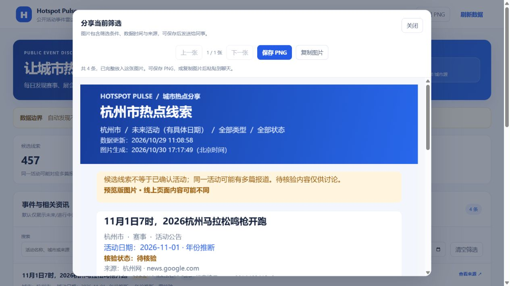

# PNG图片导出验收

新增「导出 PNG」→ 分享预览 →「保存 PNG」/「复制图片」。导出与当前城市、日期、内容性质、类型、搜索和核验状态筛选一致，预览打开后保持当时快照。长列表完整分张，支持上一张/下一张；无结果时禁用导出。

图片保留原有待核验/已核验标签、日期复核提示、来源、来源发布时间、线索编号、筛选条件、数据时间与生成时间。导出只排版当前显示数据，不核验活动，不合并报道，不改写生产快照。使用本地Canvas生成PNG，无新增依赖、外部截图服务或桌面录屏权限。

本机预览图片带「预览版」标记，网页入口指向公开GitHub Pages地址。该地址可供同事在线访问已发布版本；本分支功能未发布前，旧线上页面没有新按钮。

## 实际浏览器验证

在127.0.0.1预览独立分支，使用固定457条历史快照；没有重新采集或改写site/api/v1数据。

| 检查 | 结果 |
|---|---|
| 默认未来视图 | 精确20条，导出按钮可用 |
| 杭州筛选 | 精确4条，图片仅包含这4条报道 |
| 实际PNG下载 | 已通过浏览器「保存 PNG」下载，1080×1748，654231字节 |
| 中文与长标题 | 下载后逐项查看，中文、日期、待核验提示、长标题、来源与页脚完整 |
| 全部457条 | 分成20张；第1张7058像素高，第2张7058像素高；未超过7200限制 |
| 分张导航 | 第1张上一张禁用；下一张到2/20，再返回1/20 |
| 已核验筛选 | 0条，导出按钮禁用 |
| 浏览器控制台 | 未读取到error/warn日志 |
| 复制图片 | 支持时显示入口；系统剪贴板未实际写入，拒绝权限后的保存PNG回退通过自动测试 |

18项网页测试通过，覆盖原筛选回归、导出筛选集合、529条输入的完整分张与尺寸上限、中文/emoji换行、超长单条明确失败、空结果、PNG编码失败及剪贴板拒绝回退。未声称手机、所有浏览器或系统剪贴板兼容性全部通过。

## 实际输出与界面

[下载实际生成的杭州PNG](images/png-export-hangzhou-2026-10-30.png)

PNG SHA-256：`7433e4d4ae8fb25953fc4d297f9447b15d6caacc0e40142536831b0beb80a092`。

## 发布范围

本次仅实现并验证图片分享功能，继续在独立草稿分支。未合并、部署、启用计划、触发真实采集或升级verified；不改变现有严格事实放行FAIL结论。
